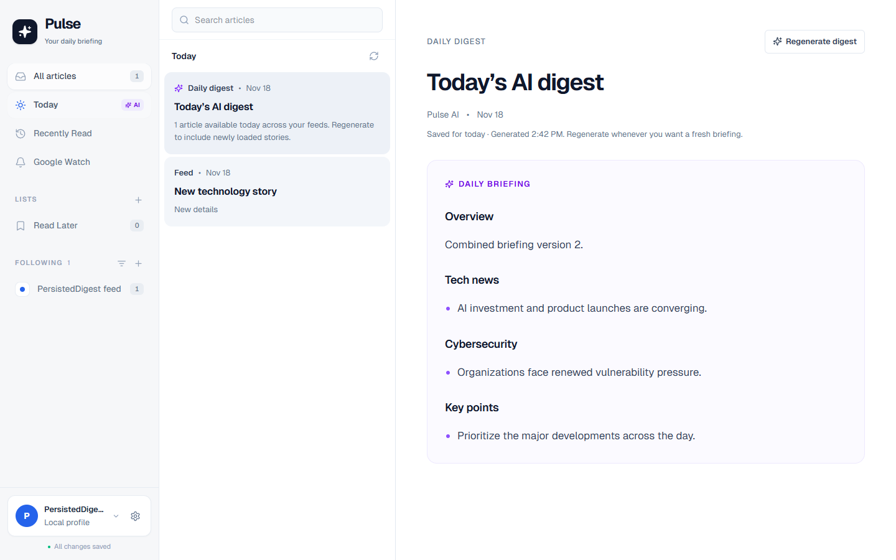
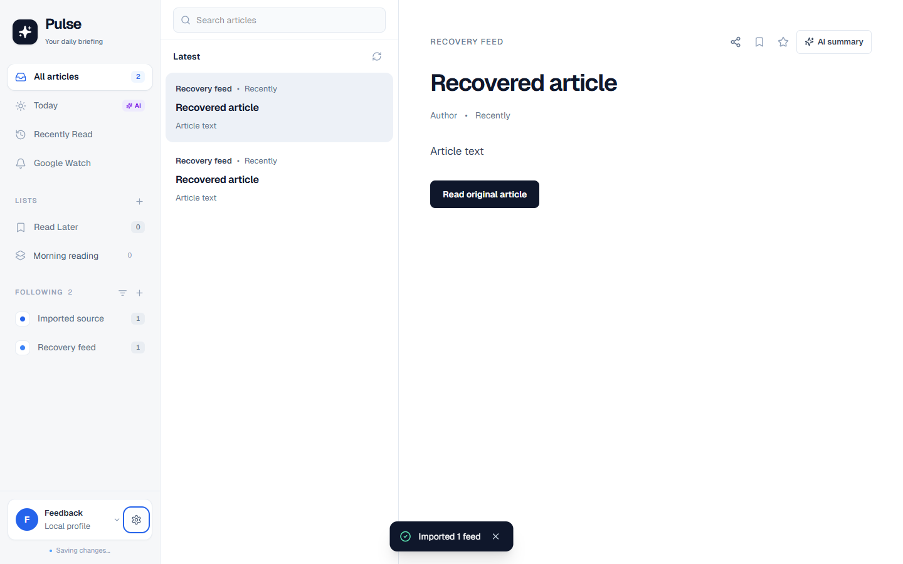

# Pulse

A responsive RSS reader built with Next.js, Tailwind CSS, SQLite, and Ollama.

## Screenshots

### Daily AI digest



### Article recovery and reader



## Features

- Hundreds of technology and cybersecurity RSS sources
- Custom RSS feeds, OPML import/export, and feed lists
- Google News keyword and sentence watches
- Local profiles with persistent subscriptions and preferences
- Saved articles, Read Later, recently read history, and unread-style source counts
- Daily AI briefing with Ollama
- Search, category filters, source favicons, feed-health diagnostics, and browser notifications
- SQLite persistence in Docker with profile-specific state

## Run with Docker

Install and start Ollama on your host, then pull a model:

```bash
ollama pull llama3.2
```

Ollama must accept connections from Docker (set `OLLAMA_HOST=0.0.0.0:11434` in its environment and restart Ollama). Limit access to your trusted network.

```bash
docker compose up --build
```

Open http://localhost:3000. Compose connects to Ollama at `http://host.docker.internal:11434`.
The default model is `llama3.2`; set `OLLAMA_MODEL` in the app environment to change it.
You can also select a model and an Ollama address in Settings. Addresses are resolved by the app server.

## Local development

```bash
npm ci
npm run dev
```

Outside Docker, the default Ollama address is `http://localhost:11434`.

## Data and profiles

SQLite stores profiles, subscriptions, lists, preferences, saved articles, read-later, and reading history.
Docker keeps the database in the `pulse-data` volume. Local development uses `.data/pulse.db`;
set `PULSE_DATA_DIR` to override it. Back up this database before removing the Docker volume.
Existing browser data is migrated for the previously active profile when it is first loaded.
Profiles are local identities, with no authentication; run this app on a trusted host/network.

## Daily digest

Today starts with a combined AI briefing: an overview, tech and cybersecurity highlights,
and key points. The first successful digest is saved in SQLite for that profile's local
calendar day and reused across reloads and devices, including while Ollama is offline.
New articles do not automatically replace it. Use **Regenerate digest** to create a fresh
briefing from the currently loaded articles. Failed regeneration preserves the saved digest.
A new local day starts a new digest.

## Checks

```bash
npm run lint
npm run build
npx playwright install chromium
npm test
```

Tests use an isolated database under `.test-data`. To use an installed browser instead,
set `PLAYWRIGHT_CHANNEL` to `msedge` or `chrome`.

For a local production preview, run `npm run build` followed by `npm start`.
